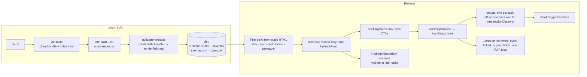

# Hallway

**An award-style, motion-led marketing site for a fictional AI operations platform for UK letting agents.**
React 18 · Vite · TypeScript (strict) · Tailwind CSS v4 · GSAP + ScrollTrigger · Lenis · Framer Motion · prerendered to static HTML.


> Hallway is fictional. Agencies, people, quotes and figures on the site are illustrative.

**Live site:** _add your deployment URL here_ · **Design system:** `/playground`

---

## Results

Measured on the production build (prerendered, served exactly as a static host would), on a
laptop (Core i5-1135G7) with Lighthouse 13.6 via `@lhci/cli` (default mobile emulation: slow 4G, 4× CPU slowdown).

| Page       | Mobile Perf (median)   | Desktop Perf | Accessibility | Best Practices | SEO     | Mobile LCP | CLS |
| ---------- | ---------------------- | ------------ | ------------- | -------------- | ------- | ---------- | --- |
| `/`        | **91** (5 runs: 88–94) | **100**      | **100**       | **100**        | **100** | 0.77 s     | 0   |
| `/product` | **96**                 | **100**      | **100**       | **100**        | **100** | 0.76 s     | 0   |
| `/pricing` | **96**                 | **100**      | **100**       | **100**        | **100** | 0.76 s     | 0   |
| `/about`   | **97**                 | **100**      | **100**       | **100**        | **100** | 0.76 s     | 0   |

| Runtime (`pnpm perf`)                                                    | Result                                                                            |
| ------------------------------------------------------------------------ | --------------------------------------------------------------------------------- |
| Scrolling the home page, desktop, full motion (Lenis + pinned section)   | **60 fps** average, p99 frame 16.8 ms, 0 frames > 25 ms, **0 long tasks**         |
| Worst interaction at 375 px with **4× CPU throttle** (Event Timing API)  | **184 ms**: menu, tabs, FAQ, pricing toggle                                       |
| Entry JS (gzip)                                                          | **139 kB** (budget 170 kB); GSAP, ScrollTrigger and Lenis load as separate chunks |
| axe-core (WCAG 2.2 AA + best practices), every route, light **and** dark | **0 violations**                                                                  |

Mobile Lighthouse on a laptop is noisy. Home's runs ranged from 0.88 to 0.94, so the table reports medians.
CI judges the median of three runs (`aggregationMethod: 'median-run'`), not the best one.

## Tech stack

| Concern   | Choice                                                                                                                        |
| --------- | ----------------------------------------------------------------------------------------------------------------------------- |
| Framework | React 18, Vite 7, TypeScript 5.9 (`strict`, `noUncheckedIndexedAccess`, `exactOptionalPropertyTypes`)                         |
| Routing   | React Router 7 data router, lazy route modules                                                                                |
| Rendering | Build-time prerender of every route (`build/prerender.ts`) + hydration                                                        |
| Styling   | Tailwind CSS v4; `@theme inline` maps a `--hw-*` token layer; light/dark themes                                               |
| Motion    | GSAP + ScrollTrigger (scroll timelines), Lenis (smooth scroll), Framer Motion `m` + `LazyMotion` (component and route motion) |
| SEO       | react-helmet-async (per-route head, prerendered), sitemap.xml, robots.txt, OG image                                           |
| Quality   | ESLint (typescript-eslint strict-type-checked, jsx-a11y strict, react-hooks), Prettier, Husky + lint-staged                   |
| Tests     | Vitest + RTL (30), Playwright (33 functional + axe + 8 visual snapshots), Lighthouse CI budgets                               |

## Architecture



```
src/
  app/          App, routes, RouteTransition (arch curtain), Seo
  routes/       Home, Product, Pricing, About, Playground, NotFound (lazy, default exports)
  components/
    ui/         Button, Heading, Text, Link, Accordion, Tabs, Tooltip, Marquee, Modal, Drawer, Toast…
    sections/   page sections (home/, product/, pricing/, shared/)
    motion/     Preloader, Cursor, SmoothScroll, Reveal, Counter, KineticWord, Spotlight
    layout/     Navbar, MobileMenu, Footer, SkipLink, DemoDialogProvider, HydrationBoundary
  hooks/        useGsapContext, useReducedMotion, useLenis, useDialogBehaviour, useTheme…
  lib/          gsap (lazy loader), scheduler, intro, scrollLock, theme, env, cn
  content/      all copy as typed objects
  styles/       tokens.css (design tokens), globals.css (Tailwind theme + utilities), fonts.css
build/          prerender, font preload plugin, preview middleware, OG image, GIF, perf profile
tests/e2e/      Playwright specs and per-OS visual baselines
```

## The signature interaction

**"Step through the door."** The product mock sits inside an arched doorway (a `clip-path`
inset with a 900px top radius). As you scroll, a scrubbed ScrollTrigger opens it to full width
while the last chat replies arrive. Route changes reuse the arch as a curtain that rises over
the old page and lifts off the new one. Under `prefers-reduced-motion` the mock is simply open
and routes crossfade in 150 ms.

## Interesting problems I solved

1. **An intro animation that doesn't cost LCP.** Hiding the headline until JavaScript animates it
   makes LCP wait for JS; hiding it after hydration makes it flash. Instead, start-hidden
   animations only run while something covers the page (`isCovered()`): the first-visit
   preloader, which an inline head script controls on a fixed 850/1150 ms timeline independent
   of JS download speed, or the route curtain. Mobile LCP: about 0.77 s.

2. **From 2,066 ms of blocking time to a 372 ms median.** Home's first profile had about 25
   motion setups (each measuring layout for ScrollTrigger) plus hydration in a few giant tasks.
   The fixes, each measured:
   - GSAP and Lenis as lazy chunks;
   - one setup per task via a `MessageChannel` scheduler;
   - IntersectionObserver-deferred setups for off-screen sections;
   - `<Suspense>` hydration boundaries per section;
   - `content-visibility` below the pinned section;
   - Lenis created on the first wheel event (phones never load it).

3. **Two bugs found while chasing performance, kept out of the shipped build.**
   - Hydrating inside `startTransition` lowered TBT, but a tap between hydration slices was
     silently dropped. An e2e test caught the mobile menu not opening, so the build uses
     selective hydration with Suspense boundaries instead: React hydrates a boundary on demand
     and replays the event.
   - Lazy-loading Framer Motion's animation features meant a fast click could start a route
     exit before the features arrived, and the old page never left. The features are now
     bundled.

4. **Prerendering a lazy-routed SPA without a framework.** A 60-line script renders every route
   with React Router's `createStaticHandler`. The client resolves the matched lazy modules
   before `hydrateRoot`, so the first render matches the HTML exactly. A `data-prerendered` guard
   renders fresh instead of hydrating if a host serves the wrong file, and a preview middleware
   makes `vite preview` behave like a static host.

5. **Accessibility found by tooling, not assumed.**
   - axe in both themes caught dark-mode tokens missing from the `prefers-color-scheme` block
     (OS-dark users got light-theme red on dark cards).
   - Dimmed story steps at 40% opacity failed contrast; they're now 60% (4.49:1).
   - A badge colour blend measured about 3.8:1, below AA.
   - `content-visibility` on the FAQ made Lighthouse sample the wrong background for its text.

   Every one is now covered by the e2e axe suite or documented in `DECISIONS.md`.

## Run locally

Requirements: Node 22 (`.nvmrc`) and pnpm 9 (`corepack enable` picks up the pinned version).

```bash
pnpm install
cp .env.example .env.local      # optional in development
pnpm dev                        # http://localhost:5173 (client-rendered dev server)

pnpm build && pnpm preview      # production build, prerendered, at http://localhost:4173
```

| Script                                               | What it does                                                                                                                                   |
| ---------------------------------------------------- | ---------------------------------------------------------------------------------------------------------------------------------------------- |
| `pnpm dev`                                           | Vite dev server with HMR                                                                                                                       |
| `pnpm build`                                         | Typecheck → client build → SSR build → prerender all routes into `dist/`                                                                       |
| `pnpm preview`                                       | Serve `dist/` like a static host (prerendered routes, `404.html`)                                                                              |
| `pnpm typecheck` / `pnpm lint` / `pnpm format:check` | Types; ESLint with zero warnings; Prettier                                                                                                     |
| `pnpm test`                                          | Vitest + React Testing Library                                                                                                                 |
| `pnpm e2e`                                           | Playwright functional + axe suite, then visual snapshots on one worker (needs `pnpm build`; first run `pnpm exec playwright install chromium`) |
| `pnpm lhci`                                          | Lighthouse CI with the budgets in `lighthouserc.cjs` (needs `pnpm build`; locally set `CHROME_PATH`)                                           |
| `pnpm perf`                                          | Scroll FPS / long tasks and interaction latency profile (needs `pnpm preview` running)                                                         |
| `pnpm analyze`                                       | Bundle treemap in `stats.html`                                                                                                                 |
| `pnpm og` / `pnpm gif`                               | Regenerate `public/og.png` / record `docs/hero.gif`                                                                                            |

A Husky pre-commit hook runs ESLint and Prettier on staged files.

## Environment variables

Client variables must be prefixed `VITE_`; they are baked in at build time and validated in `src/lib/env.ts`.

| Variable        | Required      | Example                   | Used for                                                                                                                                                   |
| --------------- | ------------- | ------------------------- | ---------------------------------------------------------------------------------------------------------------------------------------------------------- |
| `VITE_SITE_URL` | In production | `https://hallway.example` | Canonical URLs, Open Graph URLs, `sitemap.xml`, `robots.txt`. Trailing slashes are stripped. Falls back to `http://localhost:5173` with a console warning. |

## Deploying (any static host)

- Build command `pnpm build`, output directory `dist`, with `VITE_SITE_URL` set to the production origin.
- **Serve the prerendered files**: `/pricing` → `dist/pricing/index.html`. Netlify, Vercel,
  Cloudflare Pages and S3/CloudFront website hosting do this by default. Do **not** add an
  "all routes → `/index.html`" SPA rewrite; it would serve the home page's HTML for every route.
  The client detects that case and re-renders correctly, but you'd lose the prerendered HTML.
- Unknown paths → `dist/404.html` with status 404 (the default on Netlify and Vercel).
- Cache `/assets/*` for a year (`immutable`, filenames are content-hashed); don't cache `*.html`.

## CI

`.github/workflows/ci.yml` runs three jobs:

- **verify:** typecheck, lint, format, unit tests, build.
- **e2e:** Playwright functional tests, axe and visual snapshots.
- **lighthouse:** Lighthouse CI; the job fails if any budget is missed.

Visual baselines are per-OS (`tests/e2e/__screenshots__/{platform}`). The committed ones are
Windows; the first Linux CI run records Linux baselines and uploads them as an artifact to commit.

## Project docs

- [`CONTRIBUTING.md`](./CONTRIBUTING.md): conventions, the rendering and motion architecture rules, quality bars
- [`DESIGN.md`](./DESIGN.md): tokens, contrast ratios, type, motion, visual concept
- [`PLAN.md`](./PLAN.md): phase checklists
- [`DECISIONS.md`](./DECISIONS.md): 21 decision records, including the dead ends
